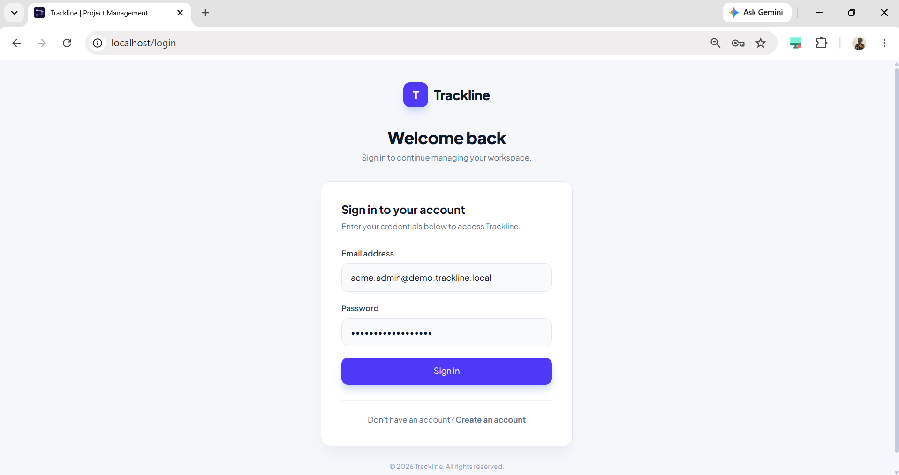

# Trackline – Multi-Tenant SaaS Project Management Platform

**One platform. Multiple workspaces. Secure project collaboration.**

Trackline is a multi-tenant SaaS project management application built using Django REST Framework, React, and PostgreSQL. It enables multiple organisations to manage projects, boards, sprints, issues, and team members independently within a shared application.

Each organisation operates within its own workspace, with role-based access control and tenant-level data isolation.

## 1. Key Features

- Multi-tenant workspace architecture
- JWT-based authentication
- Workspace creation and member invitations
- Role-based access control (Admin, Member, Viewer)
- Project and board management
- Custom workflow statuses and transitions
- Issue creation, assignment, and tracking
- Sprint planning and reporting
- Issue comments and attachments
- Audit logging
- Subscription and billing integration using Stripe
- Notifications and delivery tracking
- Docker-based development environment
- Automated CI using GitHub Actions
- Demo data generation through a Django management command

## 2. Technology Stack

| Layer | Technologies |
|---|---|
| Frontend | React, Vite, Tailwind CSS |
| Backend | Python, Django, Django REST Framework |
| Database | PostgreSQL |
| Authentication | JWT, Simple JWT |
| Background Tasks | Celery |
| Message Broker | Redis |
| Payments | Stripe |
| Web Server | Gunicorn |
| Containerisation | Docker, Docker Compose |
| CI | GitHub Actions |

## 3. Architecture Overview

```text
                       Users
                         |
                         v
                React Frontend (Vite)
                         |
                    REST API
                         |
                         v
               Django REST Framework
                         |
                 JWT Authentication
                         |
                 Workspace Resolution
                         |
                  Tenant Permissions
                         |
                 Tenant-Scoped Queries
                         |
                         v
                     PostgreSQL
                         |
                 +-------+-------+
                 |               |
                 v               v
              Audit Logs      Redis Broker
                                  |
                                  v
                            Celery Workers

                         Stripe Integration
```

### Multi-Tenant Architecture

Trackline follows a shared database and shared schema architecture. Multiple workspaces use the same database, while application-level tenant isolation ensures that users can access only data belonging to their authorised workspace.

### Tenant Isolation Layers

1. **Workspace identification:** Requests identify the active workspace using the `X-Workspace` request header.
2. **Membership validation:** Workspace permissions verify that the authenticated user belongs to the requested workspace.
3. **Tenant-scoped querysets:** API querysets filter records by the active workspace.
4. **Tenant-aware relationships:** Related objects are validated against the active workspace to prevent cross-tenant references.
5. **Automated testing:** Backend tests verify workspace isolation and access restrictions.

## 4. User Roles

| Role | Access |
|---|---|
| Admin | Workspace administration and project management |
| Member | Access and contribute to workspace projects |
| Viewer | Read-only access to permitted workspace resources |

Access is controlled through workspace membership and permission checks.

## 5. Screenshots

Screenshots of the running Trackline application are stored in `docs/screenshots/`.

### Login Page



### Dashboard


### Projects


### Board


### Issue Management


## 6. Project Setup

### Prerequisites

Install the following:

- Git
- Docker Desktop
- Docker Compose
- A modern web browser

### Clone the Repository

```bash
git clone https://github.com/venkatNagamalla/trackline-multitenant-saas.git
cd trackline-multitenant-saas
```

### Configure Environment Variables

Create the backend environment file from the example:

**Windows PowerShell:**

```powershell
Copy-Item backend/.env.example backend/.env
```

**macOS/Linux:**

```bash
cp backend/.env.example backend/.env
```

Update the environment values as required. Never commit real credentials or secret keys.

### Start the Application

Run from the project root:

```bash
docker compose -f docker-compose.dev.yml up -d --build
```

Check running containers:

```bash
docker compose -f docker-compose.dev.yml ps
```

### Run Database Migrations

```bash
docker compose -f docker-compose.dev.yml exec backend python manage.py migrate
```

### Load Demo Data

```bash
docker compose -f docker-compose.dev.yml exec backend python manage.py seed_demo
```

### Access the Application

| Service | URL |
|---|---|
| Frontend | http://localhost/login |
| Backend | http://localhost:8000 |
| Django Admin | http://localhost:8000/admin/ |

The backend root URL does not currently provide a frontend page. Use the API routes or Django Admin to access backend functionality.

### Stop the Application

```bash
docker compose -f docker-compose.dev.yml down
```

## 7. Demo Accounts

The `seed_demo` management command creates two sample workspaces with users in each role.

### Workspace 1: Acme Technologies

| Role | Username | Email |
|---|---|---|
| Admin | acme_admin | acme.admin@demo.trackline.local |
| Member | acme_member | acme.member@demo.trackline.local |
| Viewer | acme_viewer | acme.viewer@demo.trackline.local |

### Workspace 2: Nova Solutions

| Role | Username | Email |
|---|---|---|
| Admin | nova_admin | nova.admin@demo.trackline.local |
| Member | nova_member | nova.member@demo.trackline.local |
| Viewer | nova_viewer | nova.viewer@demo.trackline.local |

**Password for newly created demo accounts:**

```text
TracklineDemo@2026
```

Use the login identifier accepted by the application's `LoginSerializer` together with the password above.

> These credentials are for demonstration purposes only. The seed command sets the password when it creates a new demo user. It does not reset the password of an existing user.

### Demo Data Included

| Resource | Quantity |
|---|---:|
| Workspaces | 2 |
| Memberships | 6 |
| Projects | 4 |
| Boards | 4 |
| Workflow statuses | 12 |
| Sprints | 4 |
| Issues | 12 |
| Comments | 12 |

The seed command uses reusable database operations so it can be run again without creating duplicate demo records.

## 8. API Overview

All endpoints are served through the Django REST Framework backend.

### Authentication and Workspaces

Base URL: `/api/auth/`

| Method | Endpoint | Description |
|---|---|---|
| POST | `/api/auth/signup/` | Register a user and create a workspace |
| POST | `/api/auth/login/` | Authenticate a user |
| POST | `/api/auth/refresh/` | Refresh an access token |
| GET | `/api/auth/me/` | Retrieve current user and workspace information |
| POST | `/api/auth/invitations/` | Create a workspace invitation |
| POST | `/api/auth/invitations/<token>/accept/` | Accept an invitation |
| GET | `/api/auth/workspace/members/` | List workspace members |

### Projects and Issues

Base URL: `/api/projects/`

| Endpoint | Description |
|---|---|
| `/api/projects/` | List and create projects |
| `/api/projects/boards/` | Manage project boards |
| `/api/projects/statuses/` | Manage workflow statuses |
| `/api/projects/issues/` | Manage issues |
| `/api/projects/sprints/` | Manage sprints |
| `/api/projects/issues/<id>/comments/` | Manage issue comments |
| `/api/projects/issues/<id>/attachments/` | Manage issue attachments |

Additional endpoints support project details, issue movement, sprint start and completion, reports, attachment downloads, and workflow transitions.

### Other APIs

| Base URL | Purpose |
|---|---|
| `/api/audit/` | Audit log access |
| `/api/billing/` | Subscription status, checkout, customer portal, and webhook |
| `/api/webhooks/` | Notification management and delivery tracking |
| `/api/transitions/` | Workflow transition routes |

Authenticated workspace requests must include the required JWT authorization and workspace context.

## 9. Environment Variables

The backend reads configuration from `backend/.env`.

| Variable | Purpose |
|---|---|
| `DJANGO_SECRET_KEY` | Django security key |
| `DEBUG` | Enables or disables debug mode |
| `ALLOWED_HOSTS` | Allowed backend hosts |
| `POSTGRES_DB` | PostgreSQL database name |
| `POSTGRES_USER` | PostgreSQL username |
| `POSTGRES_PASSWORD` | PostgreSQL password |
| `POSTGRES_HOST` | PostgreSQL hostname |
| `POSTGRES_PORT` | PostgreSQL port |
| `FRONTEND_URL` | Frontend application URL |
| `CORS_ALLOWED_ORIGINS` | Allowed frontend origins |
| `CELERY_BROKER_URL` | Redis broker connection |
| `CELERY_EAGER` | Celery eager execution setting |
| `STRIPE_SECRET_KEY` | Stripe secret API key |
| `STRIPE_PRICE_ID` | Stripe subscription price |
| `STRIPE_WEBHOOK_SECRET` | Stripe webhook signing secret |

Use `.env.example` as the configuration template. Replace placeholder values with appropriate local or production settings.

**Security:** Never publish `.env` files, passwords, API keys, webhook secrets, or production credentials.

## 10. Testing and Continuous Integration

The backend uses `pytest` and `pytest-django` for automated testing.

Run backend tests from the backend directory:

```bash
python -m pytest -q
```

### Backend Test Results

```text
34 passed
```

The backend test suite completed successfully.

### GitHub Actions CI

Workflow file:

```text
.github/workflows/ci.yml
```

The CI pipeline automatically runs when changes are pushed to the `master` branch or when a pull request targets `master`.

The pipeline includes:

1. Backend tests using PostgreSQL.
2. Frontend dependency installation and production build.
3. Backend Docker image build.
4. Frontend Docker image build.

**CI Status:** All configured jobs completed successfully.

Repository: https://github.com/venkatNagamalla/trackline-multitenant-saas

## 11. Deployment

Public deployment is not currently configured. The application is packaged to run locally through Docker Compose.

A reviewer can clone the repository, configure the environment variables, and start the application using the setup instructions above.

Production deployment would require additional configuration, including production database credentials, secure environment variables, allowed hosts, HTTPS, frontend/backend domains, and Stripe webhook configuration.

## 12. Design Decisions and Trade-offs

| Decision | Reason / Trade-off |
|---|---|
| Shared database and schema | Simplifies infrastructure and reduces operational overhead; requires strict tenant filtering |
| Workspace-based access control | Supports multiple organisations and user roles |
| JWT authentication | Enables stateless API authentication |
| PostgreSQL | Provides relational data consistency and reliable transactions |
| Redis and Celery | Support background task processing |
| Docker Compose | Simplifies local setup and reproducibility |
| GitHub Actions | Automates testing and build validation |
| Application-level tenant isolation | Keeps the architecture manageable but requires consistent tenant checks |
| No public deployment yet | Keeps the project focused on a reproducible local demo; production hosting remains future work |

## 13. Future Improvements

- Public cloud deployment
- Production-grade monitoring and logging
- More comprehensive integration and load testing
- Advanced reporting and analytics
- Improved notification delivery monitoring
- Additional workspace administration features
- Further performance optimisation

## 14. Learning Outcomes

Through Trackline, I gained practical experience in:

- Designing and implementing a multi-tenant SaaS architecture.
- Building REST APIs using Django REST Framework.
- Implementing JWT authentication and role-based permissions.
- Enforcing tenant isolation across database queries and relationships.
- Working with PostgreSQL, Redis, and Celery.
- Integrating subscription and payment workflows.
- Containerising full-stack applications using Docker.
- Automating tests and build processes with GitHub Actions.
- Debugging and testing a full-stack application.

## 15. Repository

**GitHub:** https://github.com/venkatNagamalla/trackline-multitenant-saas

---

**Trackline – One platform, multiple workspaces, secure project collaboration.**